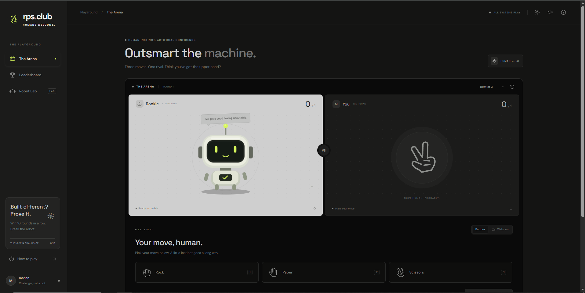

# AI Rock Paper Scissors — Robot Arena

AI Rock Paper Scissors is an interactive web-based game that combines the
classic Rock Paper Scissors experience with real-time hand gesture
recognition and an AI-powered robot opponent with a genuine personality.

Built with React, TypeScript, and Flask, the application lets players
compete against a robot using their actual hand gestures via webcam, or
simple button clicks. It features a full game arena, a global leaderboard,
and a Robot Lab for customizing your opponent.

**Live Demo:** https://ai-rock-paper-scissors.fly.dev/
**GitHub Repository:** https://github.com/aizukiontop/AI-Rock-Paper-Scissors


---

## Features

**Core gameplay**
- Real-time hand gesture recognition — show Rock, Paper, or Scissors to
  your webcam, detected entirely in-browser via MediaPipe
- Button-based input as an alternative to the webcam — both use the exact
  same backend game logic and scoring
- Single Round, Best of 3, Best of 5, and Best of 10 match formats
- A real six-phase round lifecycle (Ready → Countdown → Detecting → Locked
  → Revealing → Result), driven by the backend's own game state — not a
  frontend animation
- Win streaks that persist across matches, personal bests, win rate, and
  full round history

**The robot opponent**
- Rookie reacts differently depending on whether it's winning, losing, or
  drawing, and gets progressively angrier the longer you're on a win streak
- A **10-win challenge**: beat the robot 10 times in a row to trigger a
  one-time "you broke the robot" achievement
- **Robot Lab** — customize the robot's signature color and accessory
  (classic antenna, cat ears, or none), and preview its moods. Settings
  persist and carry over into the arena
- An optional, clearly-labeled **Adaptive Opponent** mode: when enabled,
  Rookie starts countering your most frequently played move after a few
  rounds, instead of playing uniformly at random (off by default)

**Fairness**
- The AI's move is chosen independently of the player's gesture, committed
  before the round's countdown even starts, and never changes afterward
- Round outcomes, scores, and streaks are always computed server-side — the
  browser reports what move the player made, never who won

**Leaderboard & identity**
- Pick a username (no password or email) to appear on a global leaderboard
- Three ranking categories: highest win streak, total wins, and win rate
  (which requires a minimum number of completed rounds, so one lucky game
  can't top the board)
- Returning players are recognized automatically via a locally-stored,
  server-validated token

**Other**
- Full light and dark theme, persisted across sessions
- Responsive layout across desktop, tablet, and mobile

---

## Built With

- **React** — Frontend library for building the user interface
- **TypeScript** — Static typing for more maintainable frontend code
- **Vite** — Frontend development server and build tool
- **Python** — Backend programming language
- **Flask** — Backend framework for application routes and API endpoints
- **MediaPipe Tasks Vision** — In-browser hand landmark detection and
  gesture recognition
- **Tailwind CSS** — Utility-first CSS framework for interface styling
- **Supabase / PostgreSQL** — Global leaderboard storage (optional — the
  app runs fully offline/locally without it)
- **Gunicorn** — Production WSGI server for running the Flask application
- **Docker** — Containerization for application deployment
- **Fly.io** — Application hosting and deployment platform

---

## How It Works

### Player Experience
1. Open the application in a web browser and pick a username.
2. Choose Buttons or Webcam mode, and a match format.
3. If using Webcam mode, allow camera access and show your hand gesture.
4. The robot locks in its own move independently, at the start of the round.
5. Both moves are revealed together, and the result, score, and streak update.
6. Check the Leaderboard to see how you stack up globally, or visit Robot
   Lab to customize Rookie.

### Hand Gesture Recognition
MediaPipe Tasks Vision runs **entirely in the browser** (as WebAssembly)
against the player's own webcam feed, classifying the hand into Rock,
Paper, or Scissors. Only the already-classified gesture is sent to the
backend — never raw image data — and the backend decides, at its own
chosen moment in the round, when to read it.

### Backend Processing
The Flask backend owns the actual round state machine, the AI's move
selection, scoring, player identity, and the leaderboard. It holds the
active round in memory (there's no database behind gameplay itself — see
[Deployment notes](#deployment-notes) on why that means a single worker
process), while persistent player stats and the global leaderboard are
synced to Supabase/PostgreSQL when configured.

---

## Getting Started

### Prerequisites
- Python
- Node.js
- npm (included with Node.js)
- Git

### Installation

```bash
# 1. Clone the repository
git clone https://github.com/aizukiontop/AI-Rock-Paper-Scissors.git

# 2. Open the project folder
cd AI-Rock-Paper-Scissors

# 3. Install Python dependencies
pip install -r requirements.txt

# 4. Navigate to the frontend directory
cd frontend

# 5. Install frontend dependencies
npm install

# 6. Build the frontend
npm run build
# The production build is generated in static/app for Flask to serve.

# 7. Return to the project root
cd ..

# 8. Start the Flask application
python main.py
```

### 9. Open the application

Visit: **http://localhost:5000**

> **Note:** Webcam access requires a secure context. Use `localhost` for
> local development, or HTTPS when accessing a deployed instance (the
> live demo above is served over HTTPS).

### (Optional) Enabling the global leaderboard

Without any extra setup, the leaderboard and your stats work fully
offline, scoped to your own machine. To make the leaderboard genuinely
global:

1. Create a Supabase project and run the schema in `sql/schema.sql`.
2. Set `SUPABASE_URL` and `SUPABASE_SERVICE_ROLE_KEY` as environment
   variables (see `.env.example`).
3. Restart the app — it will log that the leaderboard is running online.

The service-role key is read only by the Flask backend and is never sent
to the browser.

---

## Running the Tests

**Backend:**
```bash
python3 -m unittest discover tests -v
```
Covers the round state machine, AI fairness (including a direct check that
the AI's move-selection function has no way to receive the player's
gesture), the adaptive opponent's opt-in behavior, and the leaderboard's
three ranking categories.

**Frontend:**
```bash
cd frontend
npm test
```

---

## Project Structure

```
AI-Rock-Paper-Scissors/
│
├── frontend/                # React and TypeScript application
│   ├── src/                  # Frontend source code
│   └── package.json          # Frontend dependencies and scripts
│
├── src/                      # Flask backend application
│   ├── app.py                 # Flask application factory
│   ├── routes.py               # Application routes and API endpoints
│   ├── game_session.py         # Round state machine
│   ├── game_logic.py           # Move rules and AI move selection
│   ├── players.py              # Player identity, stats, leaderboard logic
│   └── supabase_rest.py        # Supabase REST client (server-only)
│
├── static/
│   └── app/                  # Compiled frontend assets (generated by `npm run build`)
│
├── tests/                    # Backend test suite
├── sql/
│   └── schema.sql             # Leaderboard table schema + RLS policies
├── main.py                   # Application entry point
├── requirements.txt           # Python dependencies
├── Dockerfile                 # Docker build configuration
├── fly.toml                   # Fly.io deployment configuration
├── Procfile                   # Production process configuration
├── .dockerignore               # Docker build exclusions
└── README.md
```

The structure above covers the main directories and files; additional
files may exist in the repository.

---

## Deployment

The application is deployed using **Fly.io**, with Docker preparing it for
production:

1. Install frontend dependencies.
2. Build the React application using Vite.
3. Install Python backend dependencies.
4. Configure Gunicorn to serve the Flask application.
5. Package the application using Docker.
6. Deploy the container to Fly.io.

The application is accessible over HTTPS at
https://ai-rock-paper-scissors.fly.dev/

### Deployment notes

- **Single worker process.** The active round and current player are
  in-memory state on the backend, not stored in a database — so Gunicorn
  must run with exactly one worker. Running multiple workers would let
  different players' requests land on processes that don't agree on the
  game's current state.
- **Persistent data.** Without Supabase configured, player stats live in a
  local file and won't survive a redeploy on most hosting platforms.
  Configure Supabase for stats that genuinely persist.

---

## Project Objective

AI Rock Paper Scissors was developed as an interactive full-stack web
development project to explore the integration of frontend development,
backend programming, and computer vision.

The project demonstrates how real-time webcam input and in-browser hand
gesture recognition can be incorporated into a browser-based gaming
application. It also provides practical experience in building
API-driven applications, integrating third-party computer vision tools,
managing application and game state, and deploying a full-stack project
to a cloud hosting platform via Docker.

---

## Author

**Marion Anthony S. Dingal**
Computer Science Student

- Portfolio: https://mariondingal.vercel.app/
- GitHub: https://github.com/aizukiontop

---

## Live Demo

Visit the deployed application: https://ai-rock-paper-scissors.fly.dev/

---

## Disclaimer

AI Rock Paper Scissors is a student-developed project for educational and
demonstration purposes. Webcam-based gesture recognition depends on
camera availability, lighting conditions, and hand visibility. The
application is not intended to provide professional computer vision or AI
benchmarking results.
